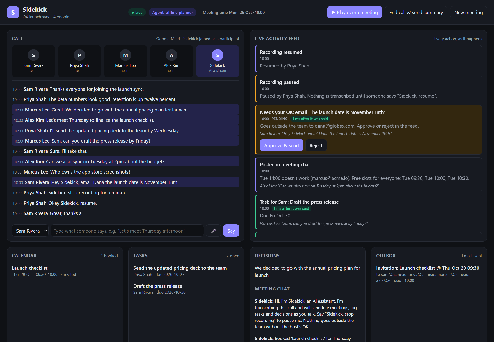
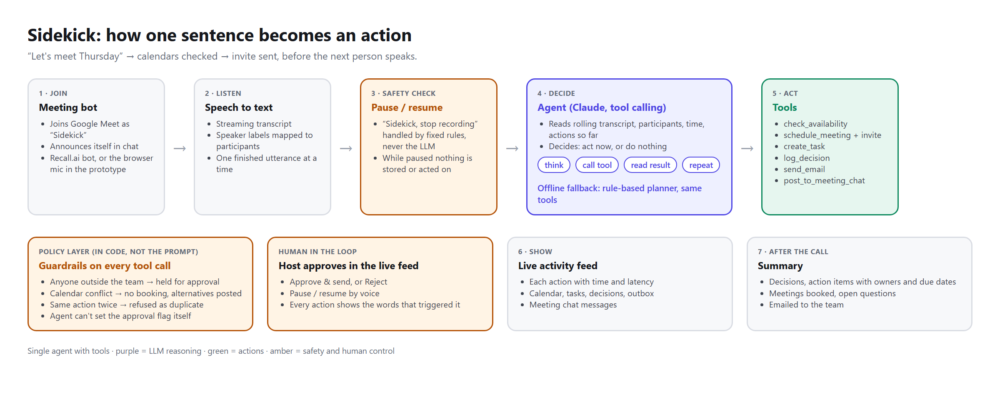

# Sidekick

**A live AI meeting agent that listens to a video call and acts while people talk.**

Someone says *"let's meet Thursday"*: Sidekick checks everyone's calendar, books the first free slot and sends the invite before the next person speaks. Someone says *"I'll send the deck by Wednesday"*: it becomes a task with an owner and a due date. When the call ends, everyone gets a summary.



## What it does

| During the call | Safety and control | After the call |
|---|---|---|
| Live transcript with speakers | Announces itself when it joins | Summary emailed to the team |
| "Let's meet <day/time>" → checks calendars → books and sends invites | Anything going **outside the team** waits for the host's approval | Decisions, action items (owner + due date), meetings booked |
| Exact time taken → no booking, posts free alternatives in chat | "Sidekick, stop recording" pauses it; nothing is stored until "resume" | Open questions nobody answered |
| "I'll do X by Friday" / "Sam, can you X?" → task | Live feed of every action, the words that triggered it, and how fast | |
| "We decided to…" → decision log | Refuses duplicate actions and calendar conflicts | |
| "Hey Sidekick, email Dana…" → email | | |

## How it works



1. **Join**: a meeting bot joins Google Meet as "Sidekick" and posts an introduction in chat. In the prototype the dashboard plays the bot's role: you can speak into the browser microphone (Chrome/Edge speech recognition), type lines as any participant, or play a scripted demo meeting. `sidekick/recall.py` connects a real Recall.ai bot when a key is provided.
2. **Listen**: each finished utterance (speaker + text) enters the pipeline in order.
3. **Safety check**: pause/resume commands are handled by fixed rules before any AI sees the text.
4. **Decide**: the agent reads the rolling transcript, participants, current time and the actions already taken, and decides whether to act.
   - **Claude agent** (`sidekick/agents/claude_agent.py`): Claude with tool calling in a think → call tool → read result → repeat loop.
   - **Offline planner** (`sidekick/agents/rule_agent.py`): pattern-based intent detection driving the same tools. It runs when no API key is set, and serves as the evaluation baseline.
5. **Act**: tools in `sidekick/tools.py` check availability, schedule meetings, send invites and emails, create tasks, log decisions and post in the meeting chat.
6. **Guardrails** (in code, not in the prompt): external recipients → held for approval; conflicts → refused; duplicates → refused; the agent cannot set the approval flag itself.
7. **Show and summarise**: every action streams to the dashboard over a WebSocket. Ending the call builds the summary and emails it to the team.

Calendar, email and tasks run against a sandbox workspace (`sidekick/workspace.py`) seeded with a fictional team's calendars, so the demo is safe and repeatable. Swapping in the Google Calendar and Gmail APIs means replacing that module; the agent and tools stay the same.

## Run it

Requires Python 3.10+.

```bash
python -m venv .venv
.venv\Scripts\activate          # Windows  (macOS/Linux: source .venv/bin/activate)
pip install -r requirements.txt
python -m sidekick.server
```

Open http://localhost:8000 and press **Play demo meeting**, or pick a speaker and type or speak. Approve or reject held messages in the feed. Press **End call & send summary** at the end.

Optional configuration (copy `.env.example` to `.env`):

| Variable | Effect |
|---|---|
| `ANTHROPIC_API_KEY` | Uses the Claude agent instead of the offline planner |
| `SIDEKICK_AGENT` | `auto` (default), `claude` or `rules` |
| `SIDEKICK_MODEL`, `SIDEKICK_EFFORT` | Claude model (default `claude-opus-5-5`) and effort (default `low`, for speed) |
| `RECALL_API_KEY` | Enables `POST /api/bot/join` to send a real bot into a Meet call |

## Tests and evaluation

```bash
python -m pytest -q          # unit tests: parsing, approvals, pause, conflicts, full demo
python -m eval.run_eval      # 16 scenario cases → eval/results_rules.md
python -m eval.run_eval --agent claude   # same cases with Claude (needs an API key)
```

Current offline-planner result: **13/16 cases pass** (11/16 before two fixes). The details and the failure analysis are in [docs/EVALUATION.md](docs/EVALUATION.md).

## Project layout

```
sidekick/
  server.py        FastAPI app: dashboard, WebSocket feed, approvals, webhooks
  session.py       join → hear → act → end pipeline, pause/resume, summary
  meeting.py       meeting state: participants, transcript, feed, approvals
  tools.py         tool schemas + guardrails (approval, conflicts, duplicates)
  workspace.py     sandbox calendar, outbox, tasks, decisions
  timeparse.py     "next Thursday at 3pm" → datetime
  agents/          Claude agent and offline planner
  recall.py        optional Recall.ai bot + transcript webhook
  demo.py          demo team, contacts and scripted meeting
web/               dashboard (HTML/CSS/JS, no build step)
eval/              evaluation cases, runner and results
tests/             unit tests
docs/              architecture, evaluation, diagrams, screenshots
```

## Tech stack

Python 3.12 · FastAPI + WebSockets · Anthropic Claude API (tool calling) · browser Web Speech API for live speech-to-text · Recall.ai (optional meeting bot) · vanilla HTML/CSS/JS dashboard · pytest.

## Known limitations

- The prototype runs against a sandbox calendar and outbox, not real Google accounts (OAuth is not wired up yet).
- The Recall.ai integration is written but has not been run end to end. It needs a paid key and a public webhook URL.
- Browser speech recognition works in Chrome/Edge, and the dashboard user picks who is speaking. Real speaker diarization comes from the meeting bot.
- The evaluation numbers are for the offline planner. The Claude agent path is implemented, but this evaluation was not run with it because no API key was available at build time.
- The offline planner misses indirect phrasing ("circle back"), third-person assignments ("Marcus will…") and can mistake some small talk for a commitment. See the evaluation for details.
- Demo state is in memory. Postgres storage for transcripts and tasks across meetings is future work.
